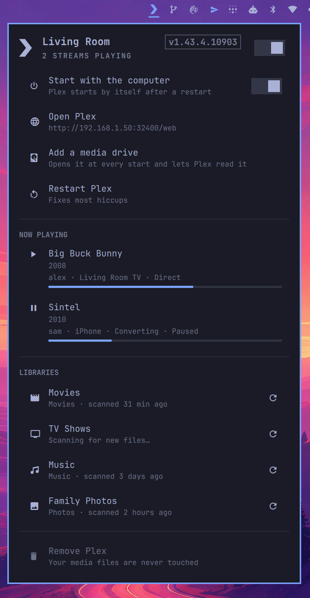
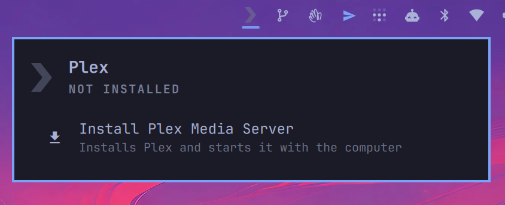
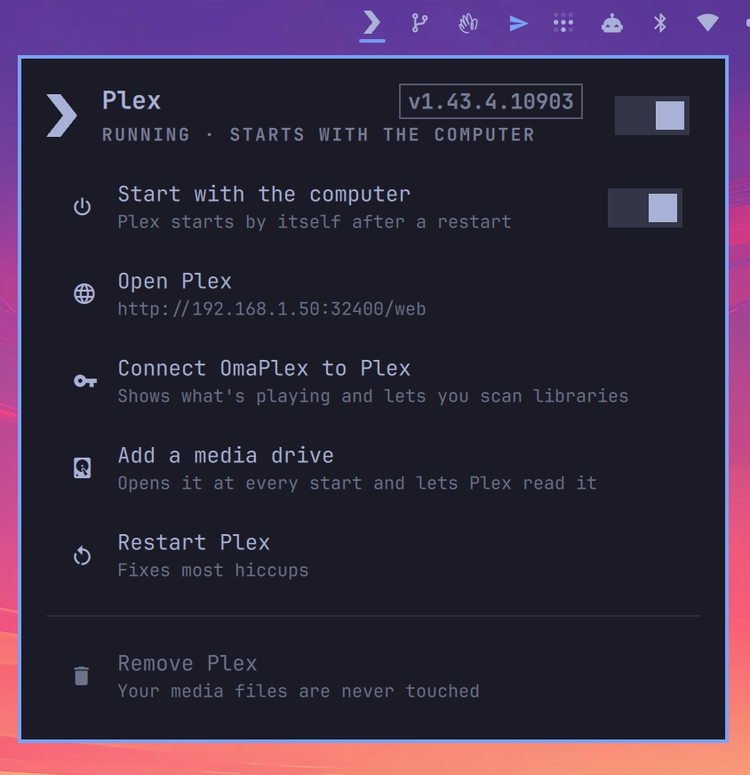

# OmaPlex

**Your own Plex Media Server, run from the Omarchy bar.**

OmaPlex sets up Plex Media Server on your computer and keeps it one click
away. Turn it on and off, have it start with your computer, see who's
watching what, look for new films and shows, and add the drives your media
lives on, all without opening a terminal or typing a command.

<p align="center">
  
</p>

## What you get

- **One-click install.** Installs Plex Media Server, starts it, and sets it to
  start every time your computer does.
- **On and off from the bar.** Start or stop Plex, and choose whether it
  starts with your computer.
- **Now playing.** See what's being watched, by whom, on which device, how far
  in, and whether Plex is converting the video or playing it as it is.
- **Libraries.** See every library and when it was last checked. Click one to
  look for new files straight away.
- **Media drives.** Set up a drive for your films, TV and music. It opens
  every time your computer starts and Plex can read everything on it.
- **The Plex icon tells you how things are.** Bright while Plex is running, dim
  while it's stopped, and your theme's accent colour while someone is
  watching something.

## Install

You need Omarchy 4.

```bash
git clone https://github.com/28allday/omaplex
cd omaplex
./install.sh
```

This adds OmaPlex to your bar, then installs Plex. When it asks for your
password, it's the one you log in with. It:

1. installs Plex Media Server
2. starts it now, and every time your computer starts
3. lets your TV, phone and other computers at home (and on your Tailscale
   network) find it
4. adds Plex to your app launcher
5. offers to set up a media drive
6. opens Plex so you can sign in

Already added OmaPlex some other way? Click the Plex icon in the bar and
choose **Install Plex Media Server**. It does exactly the same thing.

<p align="center">
  
</p>

## Getting started

1. **Claim your server.** When Plex opens, sign in with your Plex account (a
   free one is fine). This makes the server yours. Then add your libraries:
   point Plex at the folders that hold your films, TV and music.
2. **Connect OmaPlex.** Click the Plex icon and choose **Connect OmaPlex to
   Plex**. You'll be asked for your password once. After that the panel shows
   what's playing and lists your libraries.

<p align="center">
  
</p>

## Using the panel

Click the Plex icon in the bar to open the panel.

| | |
| --- | --- |
| **The switch at the top** | Turns Plex on or off |
| **Start with the computer** | When on, Plex starts by itself after a restart |
| **Open Plex** | Opens Plex, where you watch things and change settings |
| **Connect OmaPlex to Plex** | Shows what's playing and your libraries in the panel (only needed once) |
| **Add a media drive** | Sets up a drive for your media (see below) |
| **Restart Plex** | Turns Plex off and on again, which fixes most hiccups |
| **Now playing** | Who's watching what, on which device, and how far in |
| **Libraries** | Click a library, or its ↻ button, to look for new files now |
| **Remove Plex** | Uninstalls Plex. Your media files are never touched |

Turning Plex on or off, and changing whether it starts with your computer,
asks for your password. That's your computer checking it's really you.

**Mouse:** left click opens the panel, right click refreshes it, middle click
opens Plex.

**Keyboard,** with the panel open:

| Key | Does |
| --- | --- |
| `j` `k` or arrows | Move up and down |
| `Enter` | Choose the highlighted row |
| `p` | Turn Plex on or off |
| `o` | Open Plex |
| `s` | Look for new files in the highlighted library |
| `r` | Refresh |
| `Esc` | Close |

## Adding a media drive

Plug in your drive, then choose **Add a media drive**. A window opens and
walks you through it:

1. **Pick the drive.** Your computer's own drives aren't listed, so you can't
   pick the wrong one.
2. **Name it.** The drive's own name is suggested. It will appear in your file
   manager under that name, and open at `/media/<your username>/<name>`.
3. **Confirm.** From now on the drive opens every time your computer starts.
   If it isn't plugged in, your computer still starts normally.
4. **Plex gets permission to read it,** including anything you add later.
   Nothing on the drive is moved, renamed or deleted.
5. **Empty drive?** You're offered `Movies`, `TV` and `Music` folders to get
   started.

Then open Plex, add a library, and point it at the drive.

Drives formatted for Windows or a Mac (exFAT or NTFS) work as they are. If you
also use the drive on another computer, nothing changes for it there.

## Removing Plex

Choose **Remove Plex** in the panel. It stops and uninstalls Plex, closes the
network access it opened, and removes it from your app launcher. Before going
further it asks whether to:

- **delete Plex's settings, watch history and artwork** (say no if you might
  reinstall: Plex will pick up where it left off)
- **stop opening your media drives automatically**

Your media files are never touched.

To remove the OmaPlex icon itself:

```bash
omarchy plugin remove nosignal.plex
```

## Updating

```bash
omarchy plugin update nosignal.plex
```

Plex Media Server itself updates whenever you update Omarchy.

## Privacy

- OmaPlex only ever talks to the Plex server on your own computer. It doesn't
  contact any website or online service.
- **Connect** reads your server's own sign-in key from Plex's settings (that's
  the one password prompt) and keeps it in `~/.config/omaplex/token`, a file
  only you can read. **Remove Plex** deletes it.

## Troubleshooting

**The panel says "Starting…" for a while.** Plex takes a few seconds to wake
up after it starts, a bit longer the first time. Give it a moment.

**Plex can't see my files.** If the drive was set up with **Add a media
drive**, run it again for that drive. Otherwise make sure the folder is one
Plex is allowed to read. Folders inside your home folder are private to you
by default, so a separate drive is the easiest place for media.

**"Plex no longer accepts the saved sign-in."** This happens if you sign out
of Plex or reset the server. Choose **Connect** again.

**My TV or phone can't find the server.** Check that it's on the same network
as your computer, and that Plex is running (the icon is bright, not dim).

## For the curious

The panel is driven by a small helper you can use yourself:

```bash
~/.config/omarchy/plugins/nosignal.plex/bin/omaplex status    # current state, as JSON
~/.config/omarchy/plugins/nosignal.plex/bin/omaplex start     # also: stop, restart
~/.config/omarchy/plugins/nosignal.plex/bin/omaplex boot on   # or off
~/.config/omarchy/plugins/nosignal.plex/bin/omaplex open
```

From scripts, while the desktop is running: `omarchy-shell nosignal.plex
toggle` (or `start`, `stop`, `restart`, `openWeb`, `connect`, `status`).

Plex Media Server comes from the Arch User Repository package
`plex-media-server`.

## License

MIT
